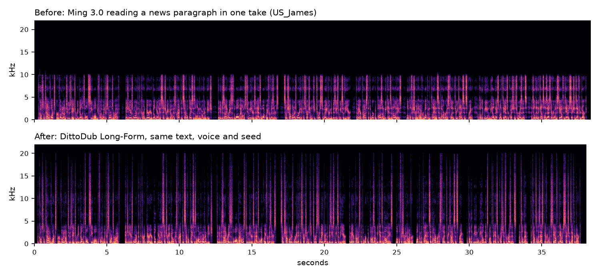

<p align="center">
  <a href="https://dittodub.com">
    <picture>
      <source media="(prefers-color-scheme: dark)" srcset="docs/img/dittodub-text-white.svg">
      
    </picture>
  </a>
</p>

# DittoDub Long-Form

**Long-form speech with [Ming 3.0 TTS 0.5B](https://github.com/inclusionAI/Ming-3.0-tts): whole paragraphs in one
continuous take, on Apple silicon.**

Made by [DittoDub](https://dittodub.com), AI dubbing and voice localization: **[dittodub.com](https://dittodub.com)**

**[Listen to the before and after](https://redavocado.github.io/dittodub-longform/)**



*US_James reading a news paragraph in one take. Top: Ming 3.0 locks into a narrow, hollow sound under 10 kHz within
the first second. Bottom: DittoDub Long-Form, same text, voice and seed.*

## Highlights

- **Reads a paragraph in one take, and longer texts as one audio stream.** No splitting into sentence fragments, no
  stitching, no audio post-processing. Stock inclusionAI weights; every change is in how the model is run.
- **Accurate.** 1.4% word error rate on held-out passages, against 10.4% for Ming 3.0 reading the same paragraphs in
  one take; skipped or repeated words in 1 of 88 takes, against 35 of 88.
- **The voice holds to the end.** No narrow-band lock-in, no slow slide into a hollow, muffled tone.
- **Fewer cracked syllables.** About a third as many sudden pitch breaks as Ming's default settings (230 short
  sentences, five voices), and fewer in long readings.
- **Faster, same sound.** 2.2x on Apple M4 Max and 2.06x on NVIDIA RTX 5090, with bit-identical output
  ([Speed](#speed)).
- **Easy.** One install command; clone a voice from a short clip; numbers, money and dates are read correctly.

## Before and after

### One paragraph in one take

Held-out test: six English passages (news, dialogue, science, a letter, a recipe, an essay; 96-139 words, 30-55 s
each) and a Mandarin one, two seeds, five built-in English voices (US_Stella was never used while developing the
method), two cloned voices and two Mandarin voices: 88 takes.

| | Ming 3.0, one take<sup>1</sup> | DittoDub Long-Form |
|---|---|---|
| Word error rate | 10.4% | 1.4% |
| Takes with skipped or repeated words | 35 of 88 | 1 of 88 |
| Built-in English voices: word error rate, failed takes | 7.3%, 20 of 60 | 1.0%, 0 of 60 |
| Cloned voices: word error rate, failed takes | 19.8%, 15 of 24 | 2.1%, 1 of 24 |
| Timbre drift, first third / last third<sup>2</sup> | 4.0 / 5.8 dB | 2.6 / 3.0 dB |
| Speaker similarity to the voice, start / end of take<sup>3</sup> | 0.868 / 0.807 | 0.928 / 0.914 |

### A four-minute reading

Ming 3.0's own long-text mode cuts the text into fragments of a sentence or two and reads each one separately, so the
delivery restarts every sentence or two. DittoDub Long-Form reads each paragraph in one take. Six paragraphs, about
four minutes, three voices:

| | Ming 3.0 default (short fragments) | DittoDub Long-Form |
|---|---|---|
| Word error rate | 0.8-1.6% | 0.7-1.8% |
| Sudden pitch breaks per voiced minute (George / Emma / Stella) | 31.1 / 5.7 / 23.3 | 7.4 / 1.6 / 20.2 |
| Context while reading | a sentence or two | a whole paragraph |
| Time on an M4 Max for 4 minutes of speech | about 2.5 min | about 70 s |

### Cracked syllables

In short single sentences (230 sentences, five voices), Ming 3.0's default settings produce 1.36 sudden pitch breaks
per sentence; DittoDub Long-Form produces 0.48. The two cracks a listener reported on our first Ming examples
(Charlotte's "owner", James's "way") reproduce exactly with Ming's defaults; with DittoDub Long-Form the 14-semitone
jump in "owner" falls under 1 semitone and "way" is voiced more cleanly (harmonics-to-noise 10.5 -> 16.9 dB). Both are
on the [listening page](https://redavocado.github.io/dittodub-longform/).

### Voice similarity

For cloned voices the real speaker is the reference. Against each speaker's own clip (six voices), single sentences
score 0.929 with DittoDub Long-Form and 0.922 with Ming's default settings, and long takes keep their similarity
from start to end (0.896 / 0.884). Built-in voices have no recording to compare with: their long takes stay close to
the voice's own single sentences (table above), and their colour sits slightly apart from Ming's default sentences,
because guiding only the early flow steps removes the sharpening that late guidance adds.

<sup>1</sup> The same model reading the paragraph in one generation, with its position limit raised so the
paragraph fits (stock tools refuse anything past 512 positions), guidance 0.5, no other changes.
<sup>2</sup> Per sentence, the 1/3-octave spectrum of the take against a fresh single-sentence take of the same
sentence by the same voice; fresh takes of a sentence differ from each other by about 2 dB.
<sup>3</sup> CAM++ speaker-embedding cosine of the first and last third of each take against the voice's own single
sentences (guidance 0.5); two sets of single sentences from the same voice score 0.92-0.98 against each other.
Word errors from a Whisper transcript aligned to the text; a failed take has a run of four or more skipped or
repeated words or a missing ending.

## Speed

| Hardware | Software | Stock kernels | DittoDub kernels | Output |
|---|---|---|---|---|
| Apple M4 Max | MLX, this package | 0.62 | **0.28** (2.2x faster) | bit-identical to stock |
| NVIDIA RTX 5090 | PyTorch, official Ming code, [`nvidia/`](nvidia/) | 0.340 | **0.165** (2.06x faster) | bit-identical to stock |

Real-time factor: seconds of computing per second of speech (lower is faster).

**Mac (Metal).** Fused and cached Metal kernels for Ming's language model, flow head and audio decoder, from DittoDub's
Ming accelerator. They give the same numbers as stock MLX: on an M4 Max, full readings (English, a cloned voice,
Mandarin) are bit-identical with and without them. At startup the package checks this on your Mac (a language-model
step, a flow-head sample and an audio decode on fixed inputs, compared with stock) and falls back to stock MLX if
anything differs. `--no-fast` turns them off.

**NVIDIA (CUDA).** [`nvidia/`](nvidia/) is a separate package for Ming 3.0's official PyTorch inference: conditioning
and constants reused across the ten flow steps, the flow solver captured in CUDA graphs, fused normalization, and
unused vocabulary logits skipped. Audio, latents and random-number state are bit-identical to stock CUDA. It covers
Ming's standard generation; the long-form method itself runs on Apple silicon.

**Memory when cloning.** The reference clip is transcribed with Qwen3-ASR one layer at a time instead of as one big
graph: the same operations in the same order, so the encoder output, every decoding step and the transcript are
byte-for-byte those of stock mlx-audio (checked on nine clips, English and Mandarin, 2 to 120 s). A 10 s clip peaks
at 1.14 GB instead of 1.79 GB, and the transcriber is freed before Ming starts speaking. Over a whole cloning run on
an M4 Max, peak Metal memory falls from 4.5 to 3.9 GB, and from 3.8 to 2.8 GB while speaking; the audio is
unchanged.

## Install

Requires an Apple silicon Mac and Python 3.10+.

```sh
pip install git+https://github.com/RedAvocado/dittodub-longform
```

The model (about 2.8 GB) downloads from Hugging Face on first use.

## Use

```sh
dittodub-longform "A short passage to read." -o speech.wav
dittodub-longform --file chapter.txt -o chapter.wav --voice UK_George
cat chapter.txt | dittodub-longform -o chapter.wav

# clone a voice from a 5-15 s clip of one speaker (it is transcribed automatically)
dittodub-longform --file chapter.txt -o chapter.wav --reference me.wav
```

```python
from dittodub_longform import LongForm

tts = LongForm()
audio = tts.speak(open("chapter.txt").read(), voice="US_Emma")   # 44.1 kHz mono float32
tts.save(audio, "chapter.wav")
audio = tts.speak("Read this in my voice.", reference="me.wav")
```

Voices: `US_Emma` (default), `US_James`, `US_Stella`, `UK_George`, `UK_Charlotte`, and Ming's 100+ Chinese voices (for
example `灵小柔`, `灵岩`). A Chinese voice without a bundled primer gets one made on first use (about a minute, then
cached). Separate paragraphs with a blank line; another `--seed` gives another reading of the same text.

Numbers, money, dates, times, units and common abbreviations are spelled out before synthesis ("$3.50" ->
"three dollars and fifty cents"); turn this off with `--no-normalize`.

## How it works

1. **Primer.** The context starts from a short clip of the same voice that the model generated itself, passed in
   through Ming's own voice-reference input. Long prompts can otherwise push a built-in voice into a narrow-band
   (~10 kHz) "recording mode" within the first second or two, and the model keeps whatever bandwidth its own
   history has. The primer is context only; it is not in the output. For a cloned voice, the reference clip plays
   this role.
2. **RoPE scaling.** The language model was trained on sequences up to 512 positions; a long take runs past that.
   NTK-aware scaling of the rotary position base keeps long distances in the trained range.
3. **Reading-position guard.** Two attention heads in the language model (layer 10, heads 12 and 13) follow where
   it is reading. Text more than a few tokens behind that point is masked, so it cannot jump back and re-read.
   Late in a long take the model is drawn towards the end of the passage; when the heads suddenly land far ahead,
   the last few audio frames are discarded and regenerated with the text beyond the reading point hidden for a
   moment (and no stopping), so the skip never reaches the audio.
4. **Guidance on the early flow steps only.** Each 80 ms audio frame is produced by ten flow-matching steps with
   classifier-free guidance. Guidance on the late, fine-detail steps compounds over a long take into a slow drift of
   the voice's timbre, and cracks some syllables. Guiding only the first six steps keeps the articulation and removes
   most of both.
5. **Paragraph takes.** Ming 3.0 0.5B was trained on short text and cannot keep its place in a multi-paragraph prompt,
   so a longer text is read one paragraph (up to about 130 words) per take, each from the same primer, and all takes
   are decoded as one continuous audio stream.

## Limits

- The long-form method runs on Apple silicon (MLX).
- Delivery does not carry across paragraph boundaries; within a paragraph it does.
- Tested in English and Mandarin. Ming's other languages (ja, ko, de, fr, es) run but are untested here.
- Cloned voices are less robust than built-in ones (in one four-minute cloned reading, three short skips), and a
  reference clip with noise or several speakers will carry that into the reading.
- US_Stella reads a little brighter (about +5 dB at 10-13 kHz) than her own single sentences.

## Credits

- [Ming 3.0 TTS](https://github.com/inclusionAI/Ming-3.0-tts) by inclusionAI (MIT): the model and weights.
- [mlx-audio](https://github.com/Blaizzy/mlx-audio) by Prince Canuma (MIT): the MLX port this builds on.
- The fast Metal kernels include Apple's MLX matrix-multiply header (MIT, see `dittodub_longform/accel/MLX-LICENSE`).
- [Qwen3-ASR](https://huggingface.co/Qwen/Qwen3-ASR-0.6B) by Alibaba's Qwen team (Apache-2.0), run through mlx-audio,
  transcribes cloning references.
- NTK-aware RoPE scaling (bloc97, 2023); guidance on a limited interval of the sampling steps
  (Kynkäänniemi et al., NeurIPS 2024).

This package also fixes one small port difference: mlx-audio samples a cloning reference's latent with the wrong
noise scale (`exp(logvar / 2)` instead of the official `softplus(scale) + 1e-4`).

Use voice cloning only with the speaker's consent.

## License

MIT. The Ming 3.0 weights are released by inclusionAI under the MIT license.

---

DittoDub Long-Form is made by [DittoDub](https://dittodub.com). Dub your videos into other languages at
[dittodub.com](https://dittodub.com). Press and logos: [dittodub.com/press](https://dittodub.com/press).
